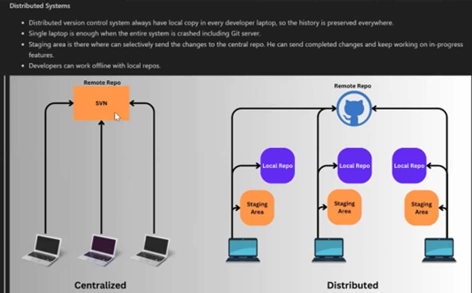
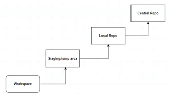
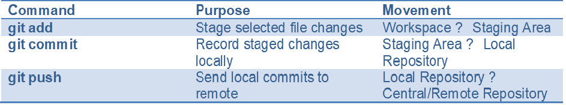

GIT – Source Code Management Notes
Note: To load the images:
press Ctrl + Shift + V (Cmd + Shift + V )

1. Why Do We Need a Source Code Management System?

A source code management (SCM) system helps developers manage source-code changes, work together, and maintain a reliable history of a project.

Version control – maintain versions of files and track how they change over time.

Track changes – identify what changed, when it changed, and who made the change.

Review changes – inspect proposed changes before integrating them.

Security and backup – preserve code history and reduce the risk of losing work.

Branching – develop features or fixes separately from the main codebase.

Collaboration – enable multiple developers to work on the same project.

Git is a popular distributed version control system. It stores repository history locally on each developer's computer and can also synchronize changes with a remote repository.

2. Disadvantages of a Centralized Version Control System

Single point of failure – if the central server crashes or becomes unavailable, the team may lose access to the repository and its history until service is restored.

Limited offline access – developers generally need to connect to the central server to perform many version-control operations.

Risk of data loss – accidental commits, incorrect pushes, or unfinished changes in the central repository can affect the shared codebase. Careful review and safe workflows are important.

Branching and collaboration can be more difficult or less flexible than in a distributed workflow.

3. Distributed Version Control Systems

Each developer has a local repository containing a copy of the project history.

If one laptop or the central/remote server fails, other repository copies may preserve the history.

A staging area lets developers select which changes will be included in the next commit.

Developers can commit changes and continue working on in-progress features without being continuously connected to the remote repository.

Developers can work offline with their local repositories and synchronize changes later.

4. Centralized vs. Distributed: Diagram

The supplied diagram compares a centralized setup, where developer machines connect to a central repository, with a distributed setup, where each developer has a local repository and staging area that can synchronize with a remote repository.

5. Original Reference Images

The original screenshots are included below for reference.

Image 1 – Source code management and centralized-system disadvantages

6. Quick Revision

Centralized system: the main repository is hosted on a central server. Distributed system (such as Git): every developer has a local repository and can work offline, then share changes with a remote repository.

7. Git Workflow: git add, git commit, and git push

The newly provided diagram shows how changes move through the Git workflow: Workspace → Staging/temporary area → Local Repository → Central/Remote Repository.

Figure 2. Git workflow showing the workspace, staging area, local repository, and central repository.

Step-by-step explanation

1. Workspace. The working directory contains the files you create or modify. Changes here are not yet staged or committed.

2. git add — Workspace to Staging Area. Select the changes you want to include in the next commit. Example: git add app.py. To stage all changes in the current directory, use git add .

3. git commit — Staging Area to Local Repository. Save the staged changes as a commit in your local Git repository, along with a message describing the changes. Example: git commit -m "Add login feature"

4. git push — Local Repository to Central/Remote Repository. Upload local commits to a remote repository so teammates and other systems can access them. Example: git push origin main

Commands at a glance
=====================

Useful reminders
=================

git add does not create a commit; it stages changes.

git commit saves a snapshot in your local repository; it does not automatically upload it.

git push uploads commits to the configured remote repository.

A common sequence is: git status → git add . → git commit -m "Describe change" → git push origin main.

Check the branch name and remote configuration before pushing, especially in shared projects.